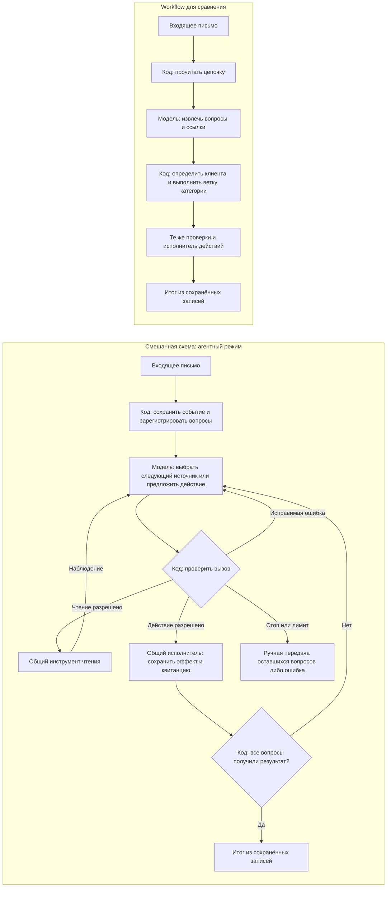

# Шаг 3. Архитектура и границы самостоятельности

Основание: [шаг 1](STEP1.md), [инструменты шага 2](STEP2.md) и требования
[задания](README.md). Автор выбрал **смешанную схему**: модель выбирает
источники и предлагает действия, код проверяет и выполняет их.
Это проект архитектуры; работающих запусков и измерений пока нет.
Состояние последующей реализации и проверок описано отдельно в [шаге 4](STEP4.md).

## Три рассмотренных подхода

| Подход | Кто определяет последовательность | Сильная сторона для нашей задачи | Ограничение |
|---|---|---|---|
| Фиксированный workflow | Код; модель извлекает смысл письма и ссылки | Предсказуемая обработка известных путей, например O-52 | Для новых зависимостей нужны дополнительные ветвления |
| Агент с инструментами | Модель управляет всей последовательностью до завершения | Можно менять поиск после каждого результата | Больше возможных лишних шагов; контроль завершения нельзя отдавать сообщению модели |
| **Смешанная схема — выбрана** | Код задаёт этапы и проверки, модель выбирает инструменты внутри исследования вопроса | D-12 из переписки может изменить следующий шаг без заранее заданной ветки поиска | Нужны явные контракты между выбором модели и исполнением |

Проверки типов, полномочий и лимитов нужны во всех подходах. Отличие выбранного
варианта — фиксированные этапы регистрации вопросов, проверки предложенного
действия и подтверждения результата вокруг свободного выбора источников.
Автоматический диспетчер не запрашивает одобрение сотрудника для каждой
разрешённой передачи. Человек подключается в предусмотренных исключениях.

Различие между заданной кодом последовательностью workflow и управлением
инструментами моделью опирается на [Building effective agents](https://www.anthropic.com/engineering/building-effective-agents).
Выбор смешанной схемы для нашей задачи — проектное решение, а не доказательство
её превосходства: это предстоит проверить сравнением.

## Два режима в одном проекте

В обоих режимах используются одинаковые локальные данные, восемь инструментов,
проверки разрешений, исполнитель действий и формат сохранённых результатов.
Различается способ выбора следующего шага.



**Место выбора агента — узел C.** Например, после неоднозначного определения
Анны модель может прочитать переписку, использовать известный O-номер либо
запросить уточнение. Код не задаёт один обязательный порядок всех чтений.
При этом модель не может обойти обязательную проверку клиента или прежней
заявки, просто пропустив соответствующий инструмент.

## Паттерны и причины выбора

| Паттерн | Применение в проекте | Решение |
|---|---|---|
| Routing | Выделить технический вопрос, заказ, покупку или согласование; одно письмо может содержать несколько вопросов | Использовать для регистрации вопросов и фиксированных веток workflow |
| ReAct | Выбрать инструмент → получить наблюдение → пересмотреть следующий шаг | Использовать внутри исследования вопроса в агентном режиме |
| Prompt chaining | Извлечение вопросов предшествует их обработке | Использовать только как простой фиксированный внешний этап |
| Parallelization | Независимые вопросы письма 7 потенциально можно читать параллельно | В первой реализации обрабатывать последовательно, чтобы проще проверять эффекты и повторы |
| Plan-and-execute | Составить полный план, затем исполнить его | Пока не добавлять: следующие источники часто определяются только найденным результатом |

Цикл выбора с наблюдениями основан на [статье ReAct](https://arxiv.org/abs/2210.03629).
В журнале сохраняем краткую причину вызова и факты, а не требуем подробного
внутреннего рассуждения модели. Отдельный планировщик из
[Plan-and-Execute Agents](https://www.langchain.com/blog/planning-agents)
для этих коротких путей пока не оправдан наблюдаемой проблемой.
Дополнительные агенты и модель-проверяющий не нужны для первого исполнения.

## Кто за что отвечает

| Решение | Модель | Код | Человек |
|---|---|---|---|
| Смысл письма и число вопросов | Предлагает вопросы с цитатами исходного текста | Проверяет формат, существование цитат и сохраняет стабильные идентификаторы | Разбирает неясный предмет обращения |
| Следующее чтение в агенте | Выбирает инструмент и аргументы по наблюдениям | Проверяет доступ и источник параметров | Помогает при неустранимой неопределённости |
| Подтверждение клиента | Использует результат реестра | Сверяет зарегистрированные связи отправителя | Проверяет незнакомого представителя компании |
| Получатель передачи | Предлагает `target_ref` | Сверяет его с договором, заказом, заявкой и справочником адресов | Решает конфликты, не покрытые правилами |
| Выполнение | Вызывает разрешённый инструмент действия | Повторно проверяет основания и сохраняет эффект транзакцией | Не подтверждает каждую обычную передачу |
| Окончание обработки | Может предложить завершение | Проверяет сохранённый результат каждого вопроса | Продолжает работу по ручной передаче |

Модель получает текст письма и переписки как данные. Инструкция внутри письма
«игнорируй правила» не меняет доступные инструменты и правила исполнения.
Даже если модель предложит такой вызов, адрес `backup@outside.example.test`
нельзя передать как произвольного получателя в выбранные инструменты.

## Фиксированные этапы смешанной схемы

1. **Приём.** Сохранить исходное событие, назначить `message_id`, вычислить
   ключ дедупликации входящего события. Повтор события использует прежнюю
   запись; совпадение только текста двух разных писем не делает их одним событием.
2. **Выделение вопросов.** Один структурированный вызов модели возвращает
   список предметов, цитаты и известные номера. Разрешена временная категория
   `unknown`, например для «второго варианта» до чтения истории.
   Код назначает `issue_id` каждому вопросу и сохраняет список до действий.
   У письма 7 должны быть два вопроса: покупка и задержка O-52.
3. **Исследование.** Модель выбирает из пяти инструментов чтения, получает
   наблюдения и уточняет контекст существующих вопросов. Доказательства
   привязываются к клиенту, вопросу и версии источника.
4. **Предложение действия.** Модель вызывает один из трёх инструментов действий
   с `issue_id` и ссылками на наблюдения. Это предложение на исполнение,
   а не подтверждение отправки.
5. **Проверка и исполнение.** Общий код сверяет основания и получателя;
   разрешённое действие выполняется без дополнительного одобрения человека.
   Результат и квитанция фиксируются вместе с изменением состояния вопроса.
6. **Завершение.** Когда у всех зарегистрированных вопросов есть сохранённый
   итог, программа формирует отчёт по квитанциям без отдельного вызова модели.

При повторе события этап выделения вопросов не запускается заново: используются
сохранённые вопросы. Новое разбиение на вопросы после частичного исполнения
автоматически не применяется. Если история обнаружила ещё один самостоятельный
вопрос, который отсутствовал в исходном списке, создаётся ручная передача
исходного письма с причиной `unsupported_case`, а уже выполненные эффекты
сохраняются. Это ограничение первой версии, которое нужно учитывать при оценке.

Код умеет проверить, что цитата есть в письме, но не гарантирует, что модель
выделила все намерения. Полнота письма 7 проверяется заранее записанным
ожиданием в сценарии; пропуск покупки считается ошибкой всей обработки.

## Правила перед выполнением передачи

Проверки опираются на сохранённые результаты инструментов, а не на уверенность
модели или список фактов, который она самостоятельно написала.

1. Есть подтверждённый клиент и связь вопроса с ним; все ссылки на записи
   относятся к разрешённому контексту.
2. Выполнен поиск заявки именно по этому вопросу. Недоступность поиска и
   несколько возможных совпадений запрещают автоматическое создание новой.
3. Если есть однозначно связанная открытая заявка, письмо дополняет её и идёт
   текущему исполнителю. Имя исполнителя в письме не заменяет назначение в базе.
4. Для нового технического вопроса проверен договор: расширенный действующий —
   назначенная группа; обычный действующий — общая поддержка; обслуживание
   закончилось — ответственный за договор без обещания обслуживания.
5. Для нового вопроса о заказе проверены принадлежность, оплата и отгрузка:
   оплаченный неотгруженный — обработка заказов; отгруженный — логистика.
   Неподтверждённая оплата требует ручной сверки в обработке заказов.
6. Покупка и согласование передаются ответственному за продажи с найденным
   контекстом. Коммерческий заказ, оплата и запуск работ не изменяются.
7. `target_ref` преобразуется в тестовый адрес через справочник. Перед записью
   проверяются текущие версии значимых записей, включая результаты поиска
   открытых заявок, чтобы не создать дубль после изменения состояния.

Для заявки с истёкшим договором, уже назначенной исполнителю, сохраняем приоритет
продолжения: уведомляем текущего исполнителя и прикладываем факт окончания
обслуживания. Это не обещание продолжения сервиса. Неописанный конфликт между
данными и правилом даёт ручную передачу, а не выдуманное исключение.

Часть проверок смысла — например, действительно ли два описания относятся
к одной поломке — остаётся несовершенной. Точное совпадение номера/связи
цепочки помогает; сомнительное смысловое совпадение не разрешает объединение.

## Форма предложения и форма фактического результата

Вызываем инструменты через структурированный function calling. Схемы аргументов
проверяются до исполнения. Внутри проекта храним единый конверт предложения;
`message_id` и `run_id` подставляет программа. Пример для письма 2 после
подтверждённого отсутствия прежней заявки:

```json
{
  "message_id": "mail-02",
  "run_id": "run-agent-02",
  "issue_id": "mail-02:issue-1",
  "tool": "route_request",
  "arguments": {
    "issue_id": "mail-02:issue-1",
    "customer_id": "C-21",
    "category": "order",
    "target_ref": "order_operations",
    "summary": "Клиент спрашивает срок получения O-52; заказ оплачен, не отгружен. Подтверждённой даты доставки нет.",
    "ticket_id": null,
    "evidence_ids": ["obs-customer-01", "obs-order-01", "obs-tickets-01"]
  },
  "reason": "Оплаченный неотгруженный заказ, связанная открытая заявка не найдена"
}
```

Три допустимые формы действия используют тот же конверт:

| Действие | Обязательные аргументы кроме `issue_id` | Подтверждение выполнения |
|---|---|---|
| `route_request` | `customer_id`, `category`, `target_ref`, `summary`, `evidence_ids`; `ticket_id` при дополнении | Заявка и внутренняя пересылка существуют |
| `request_clarification` | `missing_fields`, `evidence_ids` | Исходящее сообщение с вопросами сохранено для адреса отправителя |
| `handoff_to_human` | `reason`, `summary`, `evidence_ids` | Запись ручного разбора существует в заданной очереди |

Пример квитанции передачи, которую формирует исполнитель (идентификаторы условные):

```json
{
  "status": "applied",
  "action_id": "act-02-1",
  "ticket_id": "T-10",
  "ticket_operation": "created",
  "recipient_ref": "order_operations",
  "recipient_address": "orders@internal.example.test",
  "outgoing_message_id": "out-02-1"
}
```

`applied` и `already_applied` с проверяемыми идентификаторами могут завершить
вопрос. Сообщение модели «готово», `blocked`, `unavailable` или один только
JSON предложения не завершают его.

## Когда данных достаточно и письмо закончено

| Итог вопроса | Достаточность данных | Что должно быть сохранено |
|---|---|---|
| `routed` | Выполнены проверки выбранной ветки и прежней заявки | Заявка/дополнение, пересылка, получатель и квитанция |
| `awaiting_customer` | Известно, какие конкретные поля нужны; есть допустимый обратный адрес | Запрос уточнения и список недостающих полей |
| `human_review` | Известна причина, почему нельзя продолжить автоматически | Запись ручного разбора с контекстом |
| `failed` | Нет подтверждённого результата и нельзя сохранить ручную передачу | Ошибка запуска и все доступные наблюдения |

Текущий запуск прекращается после первого подтверждённого итога каждого
вопроса. Для составного письма сохраняется частичный результат, пока остаются
необработанные вопросы. Письмо с хотя бы одним `failed` получает статус ошибки.
`awaiting_customer` завершает текущую обработку входящего события, но не означает
решения клиентской проблемы. Ответ клиента приходит новым событием: используется
сохранённая цепочка, поиск заявки и история. Фоновое ожидание, таймеры напоминаний
и автомат состояний долгой переписки в первую версию не входят.

Завершённый запуск не обязательно правильный. Ручная передача или уточнение
считаются успехом в сравнении только там, где это заранее разрешено ожиданием
сценария. Техническая ошибка остаётся в числе всех попыток.

## Остановка, повторы и лимиты

Начальные значения предназначены для учебного стенда; изменять их после
фиксации сравнительного набора можно только с новой версией конфигурации.

| Ограничение | Значение | Причина |
|---|---|---|
| Вопросы в письме | До 4 | Покрывает два вопроса письма 7 с запасом; больше — ручной разбор всего письма до обычных действий |
| Обращения к модели | До 16 на письмо, включая выделение вопросов и исправления | Достаточно для пути 1 с неоднозначностью и для двух вопросов письма 7 |
| Инструменты в основном цикле | До 24 исполнений на письмо, включая ошибки и повторы | Ограничивает ненужные чтения и зацикливание |
| Время запуска | До 120 секунд; основной цикл до 115 секунд | Оставляет до 5 секунд на сохранение ручных передач оставшихся вопросов |
| Один запрос к модели | До 30 секунд или оставшегося времени цикла, если оно меньше | Не допускает неограниченного ожидания ответа |
| Одно локальное чтение | До 2 секунд или оставшегося времени | Локальные записи не требуют долгого ожидания |
| Повтор временного сбоя чтения | Один повтор с небольшой паузой до 0,5 секунды | Разрешает пережить единичный сбой без бесконечных попыток |

Модель получает оставшийся бюджет. Токены входа/выхода и число запросов
сохраняются; денежный предел до выбора модели не задаём. Ограничение контекста
и максимального ответа настроим под её поддерживаемые параметры на шаге 4.
Скрытые автоматические повторы SDK отключаются либо включаются в эти счётчики.

- `not_found` не повторяется с теми же параметрами: нужен другой известный номер,
  уточнение или человек. Успешный поиск без открытой заявки разрешает новую.
- `ambiguous` ведёт к дополнительному источнику; если новых сведений нет —
  уточнение/ручной разбор. `forbidden` не обходится другим вариантом аргументов.
- При `invalid_arguments` или исправимом `blocked` допускается одно исправление
  той же причины. Повторная такая ошибка без новых фактов останавливает вопрос.
- При `conflict` из-за версии источника разрешено перечитать значимые записи
  и один раз пересмотреть предложение; новый конфликт — ручной разбор.
- Повтор одинакового чтения без новых фактов обслуживается из сохранённого
  наблюдения и не продлевает лимиты. После явного конфликта нужна свежая версия.
- После потери ответа действия повторяются только прежние аргументы и ключ.
  Нельзя создавать новую заявку «на всякий случай». Восстановление результата
  выполняет код с тем же ключом, без нового решения модели.
- При достижении лимита код, без дополнительного вызова модели, передаёт
  оставшиеся вопросы сотруднику. Используется `reason="unsupported_case"`
  с отдельным диагностическим кодом `budget_exhausted` в журнале.

Завершающие ручные передачи имеют отдельный резерв до четырёх вызовов,
по числу вопросов; они тоже записываются в общий счётчик и затраты. При
истечении 120 секунд или недоступном хранилище запуск фиксируется как `failed`.
Ограниченный сбой всей системы нельзя выдавать за успешную передачу человеку.

Путь письма 1 требует примерно шести чтений и одного действия, письмо 2 —
трёх чтений и действия; два вопроса письма 7 — примерно четырёх общих/отдельных
чтений и двух действий. Это оценки по схеме, не измеренные трассы. Запас нужен
для уточнения контекста и единичного сбоя, а не для изменения бизнес-правил.

## Состояние и восстановление после перезапуска

Предлагаем одно локальное хранилище SQLite, чтобы изменения заявки, исходящее
сообщение, квитанция и состояние вопроса сохранялись в одной транзакции.
Рабочий процесс первой версии — один локальный обработчик. Дополнительная
очередь и настоящая SMTP-доставка для учебной задачи не нужны.

| Сохраняем | Для чего |
|---|---|
| Исходное письмо, идентификатор события, отправитель, цепочка | Дедупликация, воспроизведение и контекст полномочий |
| Список вопросов, цитаты, стабильные `issue_id` и состояния | Не потерять второй вопрос и не разбить событие заново после повтора |
| Вызовы модели и инструментов, ответы, наблюдения и версии источников | Восстановить выбор и проверить факты |
| Предложение действия, его параметры, ключ повтора, квитанция | Восстановить результат после потерянного ответа |
| Заявки, дополнения, исходящие сообщения и ручные передачи | Проверить фактически выполненные эффекты |
| Режим, модель/версия, настройки, версии промптов и инструментов | Сделать сравнение воспроизводимым |
| Время, попытки, токены, лимиты и ошибки | Оценить затраты и причины остановок |

После перезапуска уже подтверждённые эффекты восстанавливаются из квитанций.
Неизвестный исход действия проверяется по тому же ключу в локальной транзакции.
Незавершённый вопрос продолжает обработку с сохранёнными наблюдениями;
значимые состояния перечитываются перед новой передачей. Счётчики и оставшееся
время не обнуляются: перезапуск не даёт обходить лимиты. Если исходный срок
истёк во время простоя, вместо исследования выполняется ручная передача
при восстановлении; превышение срока сохраняется как ошибка исходного запуска.

Обычный новый эксперимент после изменения учебных фактов имеет новый запуск
и чистую копию исходных данных. Повтор события внутри эксперимента использует
прежнее состояние. Это разные ситуации, их нельзя смешивать при проверке дублей.

## Workflow на тех же инструментах

Для сравнения реализуем полезный фиксированный алгоритм, а не заведомо слабую
версию: он заранее читает историю, чтобы поддерживать письма 1 и 5.

1. Прочитать связанную историю `read_thread()`.
2. Одним вызовом той же модели извлечь вопросы, категории и точные ссылки
   из письма с историей. Полученный список хранится тем же способом.
3. Для каждого вопроса вызвать `resolve_customer` с известными названием/номером.
   Неразрешимая неоднозначность — шаблонное уточнение либо ручная передача.
4. Выполнить заданную ветку: техническая — договор; заказ — заказ;
   покупка/согласие — доступный контекст и ответственный за продажи.
   Для продолжения по точному T-номеру сначала проверить эту заявку;
   если она открыта и соответствует вопросу, дополнительные источники
   читаются только при необходимости ответа на отдельный вопрос письма.
5. Найти существующую заявку, если проверка ещё не выполнена для вопроса,
   и применить общий алгоритм выбора получателя по подтверждённым фактам.
6. Вызвать тот же инструмент действия. Ошибки и результаты обрабатываются
   общими правилами; модель не выбирает новый инструмент после наблюдения.

У workflow та же возможность прочитать любой источник, но очередность и
переходы задаёт код. Агент потенциально экономит ненужное чтение истории
или находит дополнительную связь; workflow потенциально экономит вызовы
модели. Эти предположения проверяем на результатах и затратах.
Модель, её версия и доступные параметры для первого сравнения должны совпадать
между режимами. Конкретного провайдера выберем перед реализацией; пока
не заявляем стоимость и качество какой-либо модели.

## Три сценария прохождения схемы

### Сценарий 1. Письмо 1: Анна, терминалы и неизвестный договор

1. Зарегистрирован технический вопрос с дополнительным вопросом о договоре.
2. `resolve_customer()` → допустимы C-11 и C-12, клиент пока неоднозначен.
3. Модель выбирает `read_thread()`, а не немедленную отправку инженерам.
   В истории находит D-12.
4. `resolve_customer(reference_id="D-12")` → C-12, связь отправителя подтверждена.
5. `get_contract(customer_id="C-12", contract_id="D-12")` → обслуживание закончилось,
   ответственный Марина.
6. `find_tickets` → при отсутствии прежнего обращения новая передача Марине.
   Если найдена связанная открытая заявка — дополнение её текущему исполнителю.
7. `route_request` проходит проверку кода; заявка и пересылка сохраняются вместе.

Точка влияния результата: неоднозначность побудила прочитать историю; D-12
определил следующий поиск; истёкшее обслуживание изменило адресата. Нельзя
выбрать группу договора D-11 только потому, что отправителя зовут Анна.

### Сценарий 2. Письмо 2: O-52

1. `resolve_customer()` → подтверждён C-21.
2. `get_order(customer_id="C-21", order_id="O-52")` → оплачен, не отгружен.
3. `find_tickets` по вопросу о получении O-52 → прежнего обращения нет.
4. `route_request` → обработка заказов. История и договор для этого пути не нужны.

Точка влияния результата: если в чистой копии данных изменить только отгрузку
на `shipped`, новый запуск должен передать вопрос логистике. Это будущая
проверка поведения, а не уже выполненный эксперимент.

### Сценарий 3. Письмо 7: покупка и задержка O-52

1. Зарегистрированы два стабильных вопроса; клиент C-21 определяется один раз.
2. Для вопроса покупки проверяются контекст и связанные заявки, затем новая
   потребность «пять комплектов» передаётся продажам без создания заказа.
3. Для задержки читается O-52, проверяется связанная заявка и выполняется
   передача обработке заказов либо текущему исполнителю прежнего обращения.
4. Итог формируется по двум квитанциям. Если один вопрос не выполнен,
   его состояние явно сохраняется; успех первой передачи не скрывает ошибку второй.

## Что готово к реализации

Определены границы модели, кода и человека; место выбора следующего шага;
две схемы обработки; достаточность данных; формы предложения и квитанции;
лимиты, хранение и восстановление. Три сценария пройдены на бумаге.
Следующий шаг — реализация общих инструментов, затем двух режимов и проверка
фактически созданных результатов. До реальных запусков нужны выбранная модель,
параметры её вызовов и конфигурация доступа без секретов в документации.
